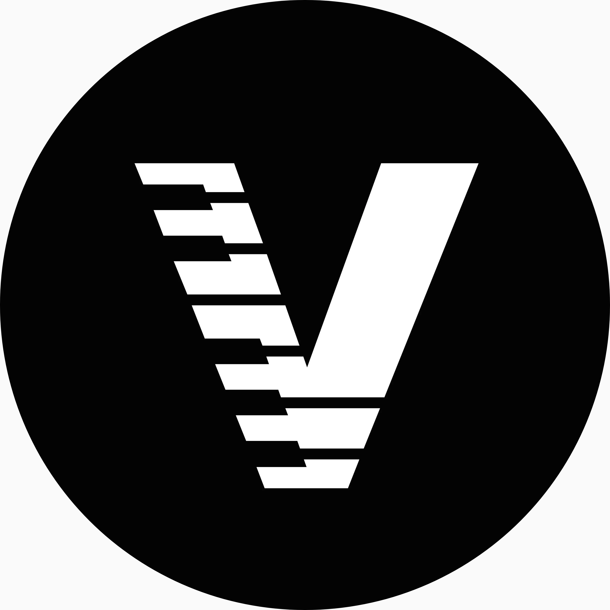
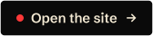

<h1>voaneves.com</h1>

  <strong>Portfolio website of Victor Neves, installable as a PWA, with dark and light themes.</strong> 
  HTML, CSS, JavaScript and SASS, in English and Portuguese

  <a href="https://voaneves.github.io/"><picture><source media="(prefers-color-scheme: dark)" srcset="https://raw.githubusercontent.com/voaneves/voaneves.github.io/main/assets/buttons/live-dark.svg" /></picture></a>
  <a href="#technology"><picture><source media="(prefers-color-scheme: dark)" srcset="https://raw.githubusercontent.com/voaneves/voaneves.github.io/main/assets/buttons/how-dark.svg" /></picture></a>

Need something like this? <a href="https://voaneves.com/en/#contact"><strong>Let's talk →</strong></a>

  
  

  <a href="https://voaneves.github.io/">Site</a> ·
  <a href="#technology">Technology</a> ·
  <a href="#progressive-web-app">PWA</a> ·
  <a href="#themes-and-languages">Themes</a> ·
  <a href="#contact">Contact</a>

<picture>
  <source media="(prefers-color-scheme: dark)" srcset="https://raw.githubusercontent.com/voaneves/voaneves.github.io/main/assets/brand/rule-dark.svg" />
  <source media="(prefers-color-scheme: light)" srcset="https://raw.githubusercontent.com/voaneves/voaneves.github.io/main/assets/brand/rule-light.svg" />
  
</picture>

## About the project

The source of Victor Neves's portfolio website: his web presence, CV and a timeline of skills, built to showcase the work and to get him hired.

**Site:** <https://voaneves.github.io/>

It started from [this tutorial](https://www.youtube.com/watch?v=xV7S8BhIeBo&t=11521s) and was heavily optimized for SEO, Lighthouse score (100/100) and accessibility.

## Technology

HTML, CSS, JavaScript and SASS. The repository holds the assets needed to build the site and its documentation.

## Progressive Web App

The site is a PWA: installable and fully usable offline. Progressive Web Apps use modern browser APIs for reliability and installability from a single codebase.

## Site optimization

The site was optimized for SEO and accessibility. Google Analytics was removed on purpose because of the performance cost. You can run other site auditors against it and send a PR.

## Themes and languages

- Dark and light themes on desktop, tablet and mobile.
- A fully translated English version.

## Contributing

Want to contribute? Send a pull request or open an issue. See the [contributing guide](https://gist.github.com/PurpleBooth/b24679402957c63ec426) for the code of conduct and the pull request process.

## License

This project is licensed under the MIT License. See the [LICENSE](https://github.com/voaneves/voaneves.github.io/blob/main/LICENSE) file for details.

## Acknowledgments

- @Maclinz, for the [JS_CSS_PortfolioProject](https://github.com/Maclinz/JS_CSS_PortfolioProject) tutorial.
- [web.dev](https://web.dev), for the tutorials and guidance.

## Contact

  <a href="https://voaneves.com/en/#contact"><picture><source media="(prefers-color-scheme: dark)" srcset="https://raw.githubusercontent.com/voaneves/voaneves.github.io/main/assets/buttons/hire-dark.svg" /></picture></a>
  <a href="https://voaneves.com/en/"><picture><source media="(prefers-color-scheme: dark)" srcset="https://raw.githubusercontent.com/voaneves/voaneves.github.io/main/assets/buttons/site-dark.svg" /></picture></a>

<a href="https://linkedin.com/in/voaneves">LinkedIn</a> · <a href="mailto:victorneves478@gmail.com">E-mail</a>

  

Released under the <a href="https://github.com/voaneves/voaneves.github.io/blob/main/LICENSE">MIT License</a>.

<a href="#top">↑ Back to top</a>

